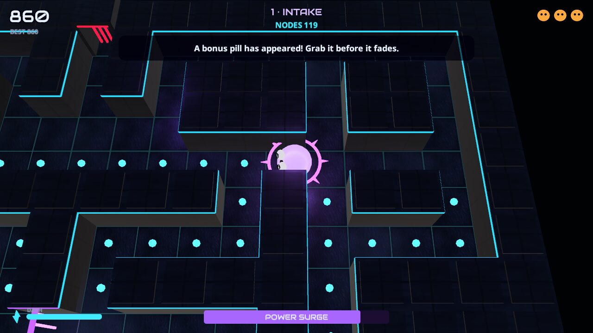
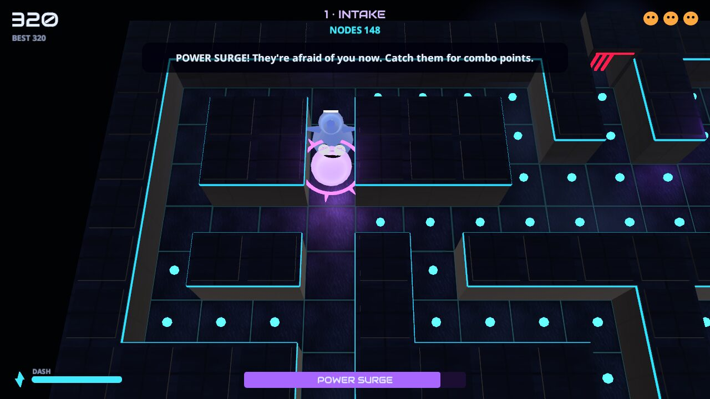
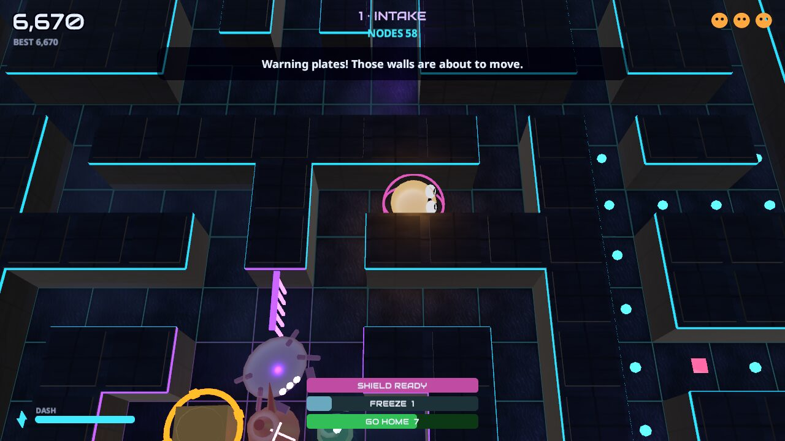
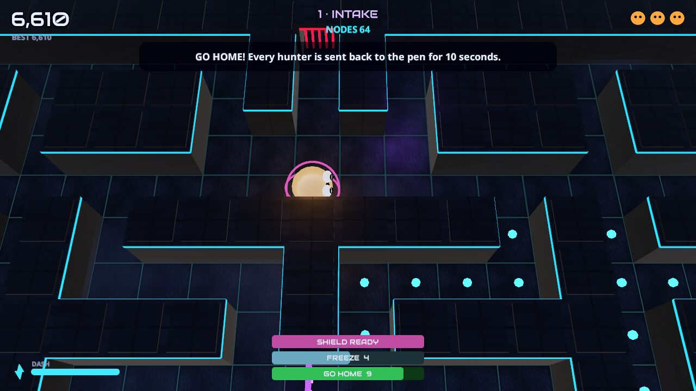
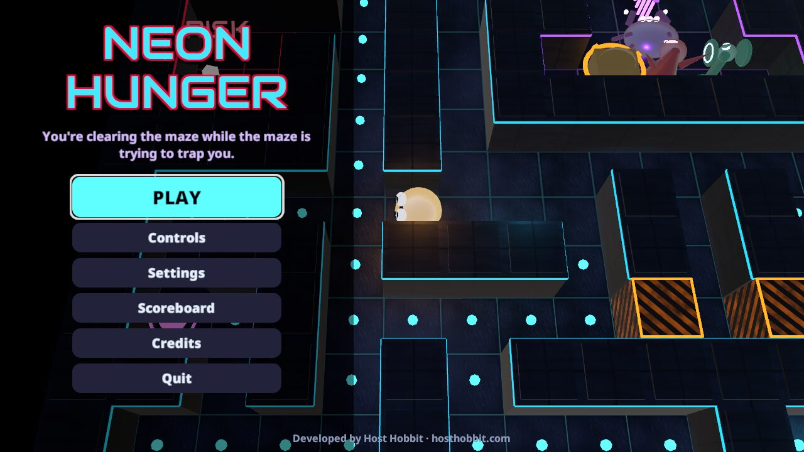
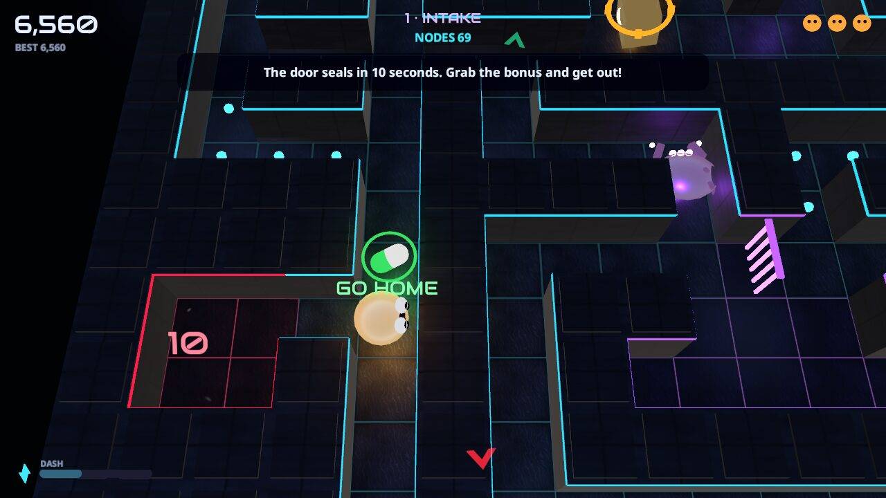
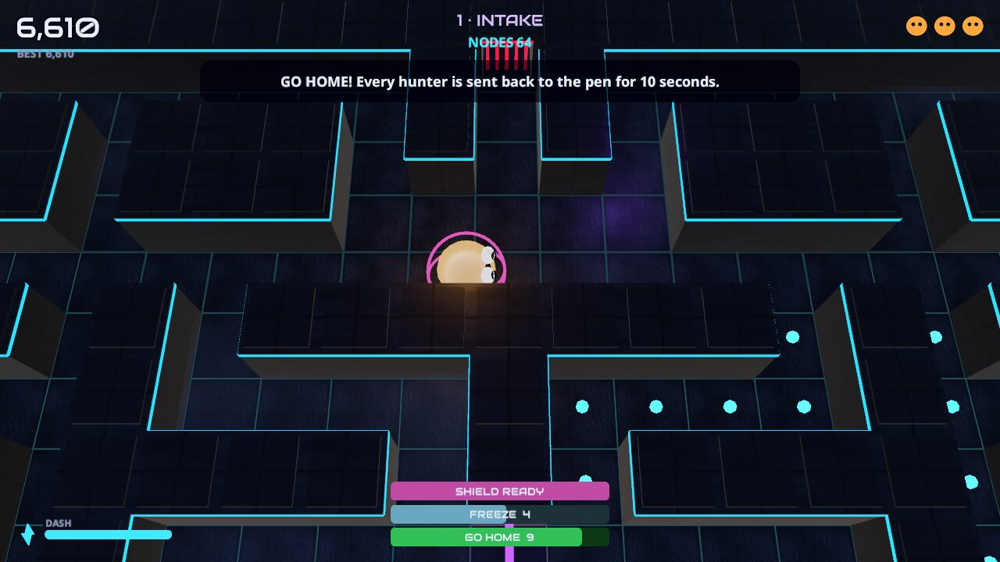
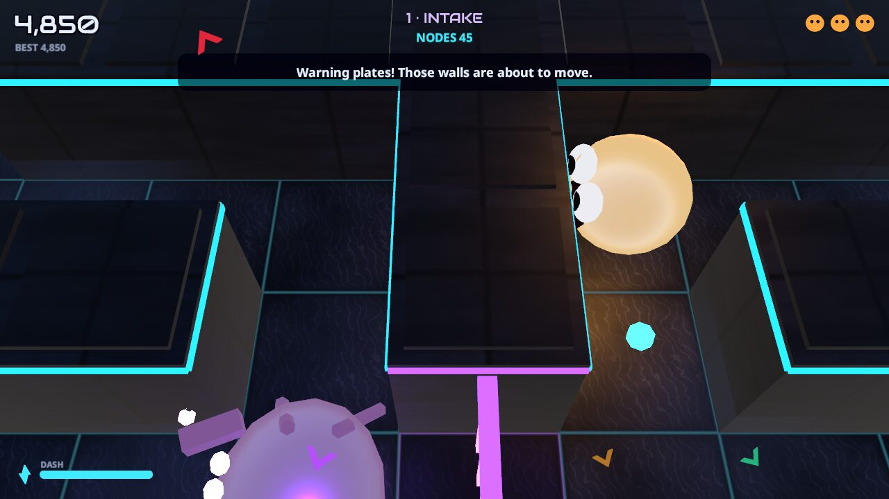
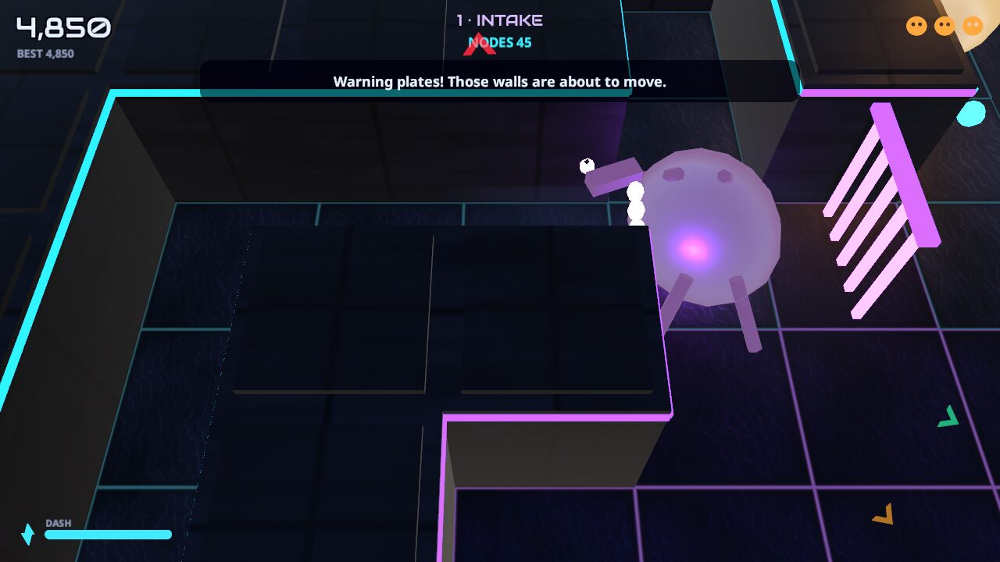

# NEON HUNGER

**You're clearing the maze while the maze is trying to trap you.**

You are a small, hungry energy creature trapped inside a sinister, living arcade machine. To escape you have to:

- eat every energy node;
- slip past four hunters with minds of their own;
- watch the walls, which move;
- reach the exit before the machine closes in.

It's a dark 3D maze chase made in Unity: atmospheric and a little frightening, with no gore.

### ▶ [Play it in your browser](https://hosthobbit.github.io/neon-hunger/)

There is a [public scoreboard](#public-scoreboard) for your best run. Developed by [Host Hobbit](https://hosthobbit.com).



| | |
|---|---|
|  |  |
|  |  |
|  |  |
|  |  |

The screenshots come from automated test runs of the real game: the Linux build and the browser build in headless Chromium. Those runs use software rendering, so they show exactly what the game draws, but not how smoothly it runs on a graphics card.

## How to play

| Action | Keyboard | Gamepad | Touch |
|---|---|---|---|
| Steer | WASD or arrow keys | left stick / d-pad | swipe |
| Dash | Space or Shift | A / right trigger | DASH button |
| Pause | Esc or P | Start | II button |
| Restart run | R | Select | (pause menu) |

- **Turns are forgiving.** A pressed direction is remembered for 0.8 s (about four tiles), so you can press early and take the next opening. A turn pressed up to 0.3 of a tile before or after a junction's centre is also taken immediately.
- **Dash** is a short burst of speed with a cooldown (the meter at bottom left). It's **loud**: hunters nearby turn to look, and the Listener comes from anywhere in the maze.
- **Energy nodes** (cyan) must all be eaten. The **EXIT** then opens in the outer wall; reach it to clear the level.
- **Power surge.** A rare violet core turns the chase around for a few seconds.
  - Your creature turns violet and spiky, the music and lighting change, and the hunters turn blue and flee.
  - Catch them for 200, 400, 800 and 1,600 points.
  - The surge bar flashes before it ends.
  - A caught hunter becomes a pair of eyes, races back to its pen, and recovers there before rejoining the hunt.
- **Living walls** are marked with amber hazard stripes.
  - A few seconds before one moves, warning plates light up on the floor and an alarm sounds.
  - A wall never moves onto anyone, and never moves if it would cut you off from a remaining node or the exit. The hunters re-plan their routes instantly.
- **Risk chambers** are optional crimson rooms holding bonus crystals worth 750 each.
  - Step inside and the door starts a countdown, shown in the room.
  - Get out before it reaches zero and the door simply seals behind you.
  - Still inside when it reaches zero, and the chamber purges, costing a life.
  - The door never closes on top of you, and nothing you need to finish the level is ever inside one.
- **Gems** (crimson, 300) sit in exposed spots near the hunters.
- **Bonus pills** appear one at a time at a random safe spot: the first after 10 s, then one 16 s after the previous pill is taken or fades. Each lasts 15 s and blinks before it fades. They score nothing, but they help:

  | Pill | Effect |
  |---|---|
  | **GO HOME** (green) | Every hunter out in the maze races back to the pen as a pair of eyes and stays there for 10 s. Hunters still in the pen stay there too. |
  | **FREEZE** (ice blue) | The hunters are frozen solid for 6 s. Touching a frozen hunter is safe. |
  | **SPEED** (yellow) | You move 35% faster for 8 s. |
  | **SHIELD** (pink) | The next hunter to catch you is sent back to the pen instead. It lasts until it's used, or until you lose a life. |

  A timer bar for each active pill is shown at the bottom of the screen.

You have 3 lives and gain one extra life at 10,000 points. Your settings and personal best are saved on your device.

### The hunters

| Hunter | Look | Behaviour |
|---|---|---|
| **Stalker** | tall crimson spike with a slit eye | heads straight for you; grows impatient when the maze is nearly clear |
| **Ambusher** | low violet crawler with three eyes and claws | heads for the junction ahead of you, to cut you off |
| **Warden** | squat amber sentinel with a spinning lantern ring | guards the power cores, gems, risk doors or exit nearest to you, patrols between them, and chases when you come close |
| **Listener** | thin teal stalk with glowing dish ears | wanders, follows your footsteps when near, and hunts down the source of any dash it hears |

- **How they move:** every hunter paths through the current maze, so they obey every wall, sealed door and moved wall.
- **Hearing them:** each hunter has its own voice, played in 3D so you can hear where it is.
- **Off-screen warnings:** arrows at the screen edge point to hunters that are nearby but out of view.
- **Release timing:** at the start, and after you lose a life, they leave the pen one at a time.

### Levels

1. **INTAKE.** A gentle introduction with on-screen hints, one living wall and one risk chamber.
2. **FURNACE.** Three living-wall groups, two risk chambers and faster hunters.
3. **CORE.** A larger maze, walls that move often, the shortest surges and the fastest hunters.

### Scoring

| | Points |
|---|---|
| Energy node | 10 |
| Power core | 50 |
| Gem | 300 |
| Risk crystal | 750 |
| Hunters in one surge | 200 → 400 → 800 → 1,600 |
| Level clear | 1,000 × level |
| Time bonus | 10 per second under the level's par time |

### Public scoreboard

After a run, type a name and press **Submit score**; the top 20 are shown from the title screen. The game doesn't send a bare number. It sends the run's per-level counts: nodes, cores, gems, crystals, hunter combos, cleared, and time.

The server (`server/neon-scores.php`, hosted on hosthobbit.com):

- recomputes the score with the same point values;
- rejects runs whose counts exceed what a level contains, or that skip a level;
- rejects impossibly fast clears and unsuitable names;
- is rate-limited.

It needs no account and no API keys.

## Settings and accessibility

The settings are:

- music and sound-effect volume, and mute;
- graphics quality: Low, Medium or High;
- camera shake: full or reduced;
- flashing effects: full or reduced.

Reduced flashing keeps the surge and danger lighting changes slow and steady, and stops lamp and warning flicker.

Audio in the browser starts after your first click, tap or key press, as browsers require. Headphones help you hear where the hunters are.

## Project facts

- **Unity version:** Unity **6000.6.3f1** (Unity 6.6). It's the only editor installed on the build machine, and it includes the WebGL build module.
- **Rendering:** the **Universal Render Pipeline**, using the Forward renderer, with three quality presets.
- **Packages** (`Packages/manifest.json`):
  - `com.unity.render-pipelines.universal` 17.6.0
  - `com.unity.inputsystem` 1.20.1
  - `com.unity.ugui` 2.6.0
  - `com.unity.test-framework` 1.8.0
- **Everything is generated from code.** No third-party art or audio was used (see [ATTRIBUTION.md](ATTRIBUTION.md)).
  - The editor builder (`NEON HUNGER → Build Everything`) makes the textures, materials, post-processing and scene.
  - At runtime, each level's geometry, the creature and the hunters are built from the map data.
  - All sound is synthesised.

### Code layout

```
Assets/NeonHunger/
  Scripts/Core   pure C#, no Unity dependencies: Maze (connectivity, living walls, risk rooms),
                 Mover (grid movement with buffered turns), Hunter + HunterBrain (behaviours),
                 GameSim (the whole game rules: surge, dash/noise, scoring, lives, shifts, risk rooms),
                 Scoring, Levels, AutoPilot (test bot)
  Scripts/Game   GameManager (flow), GameInput (Input System), Settings, QaDriver (automated tests)
  Scripts/View   MazeView, PlayerView/HunterView, CameraRig, Atmosphere (lighting/post), Art
  Scripts/UI     UIManager (all screens and the HUD), UiKit
  Scripts/Audio  Sfx (synthesised audio)
  Scripts/Net    Scoreboard client
  Editor/        NeonBuilder (project, pipelines, materials, scene, builds), TextureKit
  Tests/EditMode CoreTests (37 tests)
server/          neon-scores.php (public scoreboard)
docs/            the deployed browser build (committed; see below) and README screenshots
ci/              optional custom GitHub Pages workflow
```

The rules live in one place, `GameSim`. Unity feeds it input and draws what it reports, so whole games can be simulated in tests.

## Building, and how deployment works

You need Unity 6000.6.3f1 with **WebGL Build Support** (and **Linux Build Support** for the desktop build).

```bash
./build.sh          # Linux desktop build -> Build/Linux/NeonHunger.x86_64   (./play.sh runs it)
./build-web.sh      # browser build       -> Build/WebGL/
./publish-web.sh    # browser build, copied into docs/ (the folder GitHub Pages serves)
```

The scripts expect the editor at `~/Unity/Hub/Editor/6000.6.3f1/Editor/Unity`; set `UNITY=...` to use another location. In the editor, open `Assets/NeonHunger/Scenes/NeonHunger.unity` and press Play, or use the **NEON HUNGER** menu.

### GitHub Pages: commits publish a locally made build

- **Why it's built locally:** Building Unity in the cloud needs a Unity licence stored as repository secrets, and this repository has none. Licence files and secrets are never committed. So the WebGL build is **made locally and committed** in `docs/`, next to the README screenshots.
- **How it deploys:** the repository's Pages setting is **Deploy from a branch: `main`, `/docs`**. On every push to `main`, GitHub's own Actions run ("pages build and deployment") publishes `docs/` automatically.
- **This means:** a change under `Assets/` only goes live after you run `./publish-web.sh` and commit the updated `docs/` folder. Pushing source alone redeploys the previous build.
- **The optional custom workflow** in `ci/pages-workflow.yml` also checks the build is complete before publishing. It isn't active, because pushing files to `.github/workflows/` needs a GitHub token with the `workflow` scope. The steps to enable it are at the top of that file.
- **To build Unity in CI later:** add `UNITY_LICENSE`, `UNITY_EMAIL` and `UNITY_PASSWORD` as repository secrets, and use a Unity build step (for example `game-ci/unity-builder` targeting WebGL) in that workflow.

**Hosting details for GitHub Pages:**

- **Compression:** files are gzip-compressed with Unity's **decompression fallback**. GitHub Pages can't send the `Content-Encoding` headers Unity's compressed files would otherwise need, and the fallback decompresses them in JavaScript instead. No server configuration is required.
- **Paths:** every asset is loaded by relative path, so the game works under the `/neon-hunger/` subpath. This was tested locally under that subpath and on the live site.
- **Loading page:** it shows progress, and gives useful errors if WebGL 2 is missing, the loader fails, or the page was opened as a local file.

## Testing: what was actually checked

All automated runs are GPU-free (software rendering) and muted. No real gamepad or real phone was used.

1. **Core rules: 37 tests, all passing.** They run in Unity's EditMode runner (and in .NET during development). They cover:
   - every level parsing correctly;
   - every node and the exit being reachable **in every possible living-wall configuration**;
   - risk rooms being sealed except for the door, and holding no required nodes;
   - player and hunter access rules, and the exit opening on the last node;
   - living walls refusing to move onto an actor or to cut anything off;
   - movement at constant speed, stopping exactly at walls, buffered turns being taken at junctions, stale turns being forgotten, instant reversing, and 20,000 frames of random input never entering a wall;
   - hunter release order, and each hunter's targeting rule (Stalker, Ambusher, Warden and Listener with noise);
   - hunters never entering walls, risk rooms or the exit during long bot games on all three levels;
   - surge start, warning and end, flee and recovery, and 200/400/800/1,600 combos;
   - deaths, respawn into a calm maze, and game over;
   - the extra life;
   - risk rooms trapping you if you stay, letting you go if you leave, and never closing on you;
   - living walls telegraphed at least 3 s ahead and never trapping anyone or breaking connectivity during bot play;
   - level clear and its bonus;
   - the dash cooldown and its noise;
   - the score equalling the sum of its events, and the scoreboard encoding;
   - the bot clearing every level;
   - the cornering slack (a turn pressed just past a junction is taken; with no slack it's missed), and the player's 0.8 s turn memory;
   - the GO HOME pill sending every hunter home and holding them there, including ones not yet released, then letting them out after 10 s;
   - FREEZE stopping the hunters and making them harmless until it thaws;
   - SPEED's 35% boost, and SHIELD taking exactly one catch;
   - pills only appearing on open floor that the player can reach, never in a risk room or on a living wall, and each one being taken or fading.
2. **Input test of the Linux build: 14 of 14 checks pass.** It uses virtual keyboard and gamepad devices to test:
   - title focus, and Enter starting a run;
   - held keys moving the creature;
   - a buffered turn landing exactly on the junction's centre-line;
   - walls stopping the creature exactly;
   - Space dashing;
   - the gamepad stick steering;
   - Escape pausing everything, and Enter resuming;
   - eating nodes scoring;
   - R restarting instantly;
   - settings persisting;
   - the game-over screen;
   - no console errors.
3. **Full runs of the Linux build.** The bot played through the real game flow three times:
   - **with the normal 3 lives (twice):** it cleared Levels 1 and 2, then was caught on Level 3;
   - **with spare lives:** it cleared all three levels and reached the victory screen, scoring 27,210 with 12 surges, 17 hunters caught, 7 wall shifts and 5 risk-room raids.

   All runs had zero errors. That victory run's level counts were sent to the live scoreboard server, which recomputed the identical score. Tampered scores and impossible runs were rejected.
4. **The browser build in headless Chromium (SwiftShader):**
   - It was served under `/neon-hunger/` and loads in 2–3 s from a local server.
   - Real keyboard events start a run and steer.
   - In phone emulation, real touch swipes steer.
   - There were no console errors.
   - After deployment the same checks were repeated on the live GitHub Pages site.

**Not verified:**

- Real hardware and frame rates on an ordinary desktop browser. The only numbers measured are from software rendering (about 13 fps for the Linux build on llvmpipe at 720p on High, and 6–7 fps in headless Chromium), and they don't say how fast it runs on a real GPU.
- Whether audio is actually audible in a real browser. No audio errors were logged, but headless browsers have no sound output.
- A physical gamepad or touchscreen.

## Known limitations and future ideas

- The browser download is about 16 MB, and it needs WebGL 2.
- Touch controls (swipe plus a DASH button) work, but the game is designed first for keyboard or gamepad.
- Daily challenges and online multiplayer are deliberately left for later, as the brief asked.

## Credits

See [ATTRIBUTION.md](ATTRIBUTION.md). The game, models, textures, music and sound are original. The fonts are under the SIL Open Font License. Developed by [Host Hobbit](https://hosthobbit.com).
